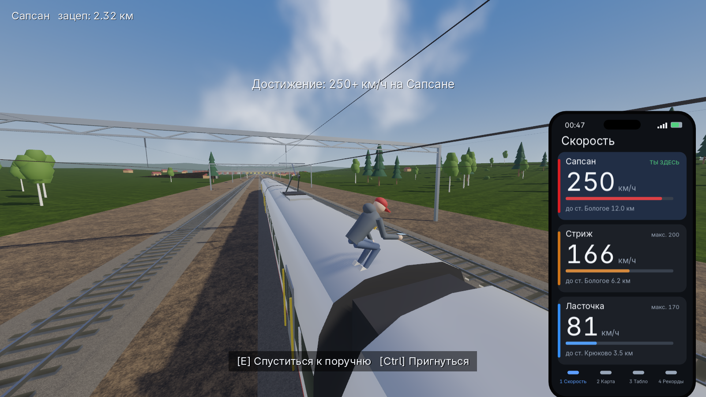
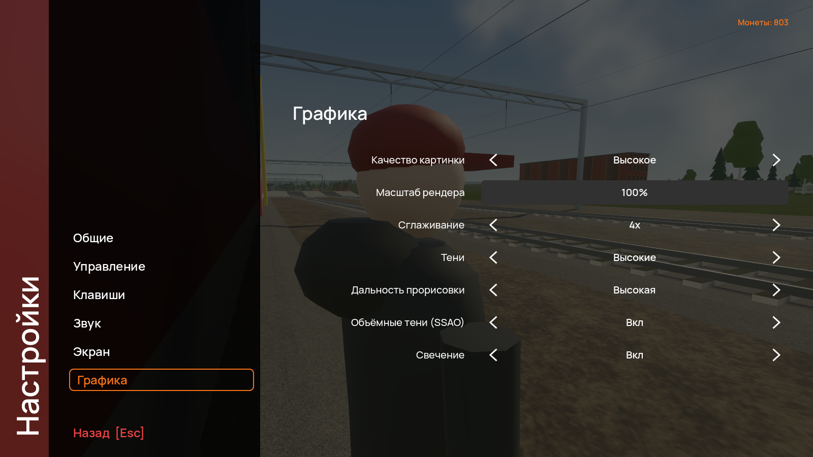

# Зацепер

3D-игра про зацепинг: цепляйся за поезда руками, выбирайся на крышу, уходи от контролёров и охраны, снимай зацепы на телефон и катайся с друзьями онлайн. Для Windows и Android.

> **Это только игра.** В реальности зацепинг смертельно опасен: контактная сеть, падения и удары о конструкции убивают людей каждый год. Не повторяйте это на настоящей железной дороге.

## Скачать

Готовые файлы лежат в разделе [Releases](../../releases/latest):

- **Windows:** `Zatseper-Setup-1.4.0.exe`, установщик. Права администратора не нужны.
- **Android:** `Zatseper-1.4.0.apk`. Перед установкой разрешите установку из этого источника.

Windows может показать предупреждение SmartScreen: установщик не подписан сертификатом разработчика.

Обновления ставятся из самой игры: при запуске она проверяет новый релиз и показывает в меню кнопку «Обновить».

## Новое в 1.4.0

- **Онлайн через интернет:** хост создаёт комнату прямо на своём телефоне или компьютере, друзья заходят из других городов. Комнаты публичные и приватные (вход по ключу), до 30 игроков, список комнат в меню «Онлайн».
- **Текстовый и голосовой чат:** Enter или кнопка «Чат» для сообщений, зажми B или кнопку «Голос», чтобы говорить.
- **Руки как в регдол-играх:** каждая рука двигается отдельно и цепляется за то, чего касается. Зацеп на любой скорости, можно перекинуть руку через край крыши и подтянуться.
- **Урон, переломы и больница:** падения и удары отнимают здоровье, сломанная нога замедляет, сломанная рука соскальзывает. Больница у каждой станции.
- **Контролёры** в половине поездок. С билетом из автомата они тебя не тронут, без билета можно открыть дверь на ходу (клавиши 1-4 в такт) и уйти на крышу.
- **Внутрь поездов можно зайти:** прозрачные окна, тамбуры с дверями между вагонами, сдвоенная Ласточка.
- **Автобусы** у каждой станции, за них тоже можно цепляться. Площади с машинами, больше людей на платформах.
- **Перчатки с липучками** для Метеора: без них на 400+ км/ч не удержаться.
- **Пантограф на верёвке:** E накинуть, R тянуть.
- **Телефон в руке:** приложение «Лента» с твоими фото и лайками, управление стрелками.
- **Свой стиль:** цвета толстовки, штанов, кепки и полоски.
- Вид от первого лица, новые анимации, достижения, мягкая атмосфера.

## Управление

| Действие | ПК | Телефон |
|---|---|---|
| Идти, бежать | WASD, Shift | джойстик слева |
| Камера | мышь | свайп |
| Прыжок | Пробел | Прыжок |
| Регдол, встать | G | Регдол, Встать |
| Двигать левую или правую руку | зажать ЛКМ или ПКМ | джойстики рук |
| Держаться левой или правой | держать A или D | отпустить джойстик |
| Действие: забраться, верёвка, билет, дверь | E | кнопка действия |
| Тянуть верёвку пантографа | R | Тянуть |
| Рестарт на станции | F | Рестарт |
| Телефон | X или Tab, стрелки и Enter | Тел |
| Вид от первого лица | V | Вид |
| Чат | Enter | Чат |
| Голос | держать B | Голос |
| Меню | Esc | II |

Клавиши можно переназначить в настройках.

## Лицензия

Игра бесплатная, но все права защищены: см. [LICENSE](LICENSE). Сторонние компоненты перечислены в [THIRD_PARTY.md](THIRD_PARTY.md).
